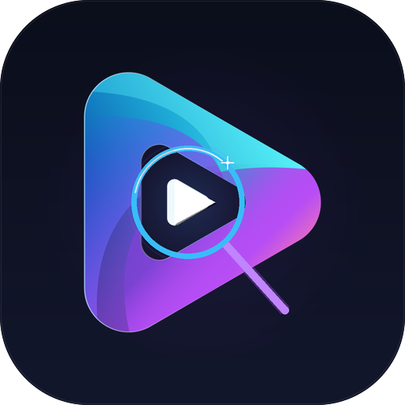

<div align="center">



# Nuvio for Google Search

**Adds Nuvio to the "Where to Watch" movie and series panel in Google Search.**

Prioritizes launching in the Nuvio Desktop application with automatic fallback to the Nuvio Web client.

[](src/manifest.json)
[](LICENSE)
[](guide/cross-browser-compatibility.md)
[](src/)

---

</div>

## Table of Contents

- [Overview](#overview)
- [Key Features](#key-features)
- [How It Works](#how-it-works)
- [Launch Experience & Modal](#launch-experience--modal)
- [Browser Compatibility](#browser-compatibility)
- [Quick Start & Installation](#quick-start--installation)
- [Configuration](#configuration)
- [Documentation Index](#documentation-index)
- [Project Architecture](#project-architecture)
- [Contributing](#contributing)
- [License](#license)

---

## Overview

When searching for movies or television series on Google, Google displays a Knowledge Panel featuring a "Where to Watch" list of streaming services. **Nuvio for Google Search** seamlessly injects Nuvio into these options.

Clicking the Nuvio option initiates a smart launch pipeline:
1. **Desktop First**: Attempts to open the title inside the local Nuvio Desktop application (`nuvio://`).
2. **Detection & Fallback**: Monitors whether the desktop application responds. If no desktop application is detected, it automatically opens the title in the [Nuvio Web client](https://nuvio-web.vercel.app/).
3. **User Choice**: Supports a native-style permission dialog allowing users to choose their preferred target, remember decisions, or prompt each time.

---

## Key Features

- **Google Knowledge Graph Integration**: Automatically attaches to the "Where to Watch" provider stack, header action buttons, or a floating action pill fallback.
- **Smart Protocol Detection**: Focus and visibility heuristics detect whether the local desktop app handled the request without throwing intrusive browser errors.
- **Automated Web Fallback**: Seamlessly redirects to `https://nuvio-web.vercel.app/` with the query pre-populated and automatically executed.
- **Native-Style Permission Dialog**: Mimics standard browser permission prompts with an *"Always allow google.com to open links in Nuvio Desktop"* option.
- **Cross-Browser Engine Support**: Manifest V3 compliant across Chromium (Chrome, Brave, Opera, Microsoft Edge, Vivaldi) and Gecko (Mozilla Firefox).
- **Zero Runtime Dependencies**: Written entirely in vanilla JavaScript (ES6+), standard WebExtension APIs, and pure CSS.
- **Dark & Light Mode Aware**: Dynamically adapts colors and contrast to match Google's active theme.
- **Strict Privacy**: Zero tracking, zero telemetry, and zero third-party analytics.

---

## How It Works

```
Google Search Query (Movie or Series)
                  │
                  ▼
   Knowledge Panel Detected
                  │
                  ▼
      [Watch on Nuvio] Button
                  │
                  ├────────────────────────────┐
                  ▼                            ▼
         Mode: "Ask Each Time"         Mode: "Smart Launch"
                  │                            │
                  ▼                            │
      Native Permission Dialog                 │
        • Open Nuvio App                       │
        • Open in Web                          │
        • Cancel                               │
                  │                            │
                  ├────────────────────────────┘
                  ▼
       Invoke Desktop Protocol (nuvio://)
                  │
         ┌────────┴────────┐
         ▼                 ▼
   App Handled      Timeout (1500ms)
   (Blur/Hidden)     No Focus Change
         │                 │
         ▼                 ▼
     Complete        Fallback: Open Web
                     (nuvio-web.vercel.app)
                           │
                           ▼
                     Auto-Execute Search
```

---

## Launch Experience & Modal

When configured in **Ask Each Time** mode (the default), clicking Watch displays a non-intrusive dialog:

- **Entity Metadata**: Displays media title, content type (Movie or TV Series), release year, and IMDb code.
- **Choice Options**:
  - **Open Nuvio App**: Triggers protocol launch with fallback verification.
  - **Open in Web**: Immediately opens Nuvio Web in a new tab.
  - **Cancel**: Closes dialog, preserves prompt-each-time behavior, and provides a subtle toast to open in web.
- **Remember Choice**: Checking *"Always allow google.com to open links in Nuvio Desktop"* saves the preference to bypass subsequent prompts. Settings can be reset at any time via the extension popup or options page.

---

## Browser Compatibility

| Browser | Supported Engine | Extension Manifest | Status |
| :--- | :--- | :--- | :--- |
| **Google Chrome** | Chromium | Manifest V3 | Fully Supported |
| **Brave Browser** | Chromium | Manifest V3 | Fully Supported |
| **Microsoft Edge** | Chromium | Manifest V3 | Fully Supported |
| **Opera / Opera GX** | Chromium | Manifest V3 | Fully Supported |
| **Vivaldi** | Chromium | Manifest V3 | Fully Supported |
| **Mozilla Firefox** | Gecko | Manifest V3 | Fully Supported |

---

## Quick Start & Installation

### Option A: Install from Pre-Built Packages
Ready-to-use release archives with self-contained directory structures are located in [`extensions/`](extensions/):
- **Chromium (Chrome, Brave, Edge, Opera, Vivaldi)**: Extract [`extensions/nuvio-google-search-chromium-v1.0.0.zip`](extensions/nuvio-google-search-chromium-v1.0.0.zip), open `chrome://extensions/`, enable **Developer mode**, click **Load unpacked**, and select the extracted folder.
- **Mozilla Firefox**: Extract [`extensions/nuvio-google-search-firefox-v1.0.0.zip`](extensions/nuvio-google-search-firefox-v1.0.0.zip), open `about:debugging#/runtime/this-firefox`, click **Load Temporary Add-on...**, and select `manifest.json`.

### Option B: Build from Source

1. Clone or download this repository:
   ```bash
   git clone https://github.com/example/nuvio-google-search.git
   cd nuvio-google-search
   ```
2. Build the distribution packages:
   ```bash
   python scripts/build.py
   ```
3. Load the generated distributions from `dist/chromium/` or `dist/firefox/`.

Detailed browser-by-browser instructions are documented in the [Installation Guide](guide/installation.md).

---

## Configuration

The extension includes a toolbar popup and a dedicated Options page:

| Setting | Default | Description |
| :--- | :--- | :--- |
| **Launch Preference** | `ask` | `ask` (dialog), `smart` (app first + fallback), `web` (web only), `desktop` (app only). |
| **Protocol Scheme** | `nuvio://` | Custom URI scheme registered by your desktop client (e.g. `nuvio://` or `stremio://`). |
| **Nuvio Web Base URL** | `https://nuvio-web.vercel.app/` | Destination URL for the web fallback client. |
| **Detection Timeout** | `1500 ms` | Duration to await desktop protocol confirmation before triggering web fallback. |
| **Floating Action Pill** | `true` | Fallback button when Google omits the streaming provider list. |
| **Web Suggestion on Cancel** | `true` | Shows toast offering web launch if app launch is cancelled in the modal. |
| **Auto-Search Web** | `true` | Pre-populates and triggers search when opening Nuvio Web. |

Full configuration reference available in the [Configuration Guide](guide/configuration.md).

---

## Documentation Index

Comprehensive technical documentation is maintained in the [`guide/`](guide/) directory:

- [Architecture Overview](guide/architecture.md): System diagrams, component lifecycle, and data flows.
- [Architecture Decision Records (ADRs)](guide/decisions.md): Technical trade-offs and decisions.
- [Design Specifications](guide/design.md): Color tokens, typography, UI components, and modal specs.
- [Google Search DOM Analysis](guide/google-search-dom.md): Reverse engineering Knowledge Panel attributes and selectors.
- [Cross-Browser Compatibility](guide/cross-browser-compatibility.md): Chromium and Firefox Manifest V3 support details.
- [Configuration Reference](guide/configuration.md): Storage keys and customization options.
- [Installation Guide](guide/installation.md): Developer sideloading and packaging guide.
- [Agent & Developer Manual](AGENTS.md): Repository guidelines, code conventions, and maintenance policies.

---

## Project Architecture

```
nuvio-google-search/
├── .github/workflows/build.yml     # Automated CI packaging
├── AGENTS.md                       # Developer & AI Agent instructions
├── LICENSE                         # MIT License
├── README.md                       # Main project documentation
├── extensions/                     # Pre-packaged release archives
│   ├── README.md                   # Packaging reference
│   ├── nuvio-google-search-chromium-v1.0.0.zip
│   └── nuvio-google-search-firefox-v1.0.0.zip
├── guide/                          # Technical guides and specifications
│   ├── architecture.md
│   ├── configuration.md
│   ├── cross-browser-compatibility.md
│   ├── decisions.md
│   ├── design.md
│   ├── google-search-dom.md
│   └── installation.md
├── src/                            # Manifest V3 extension source
│   ├── manifest.json
│   ├── background/service-worker.js
│   ├── content/google.js
│   ├── content/google.css
│   ├── content/nuvio-web.js
│   ├── icons/
│   ├── options/
│   ├── popup/
│   └── utils/
│       ├── browser-polyfill.js
│       ├── modal.js
│       ├── protocol-launcher.js
│       └── storage.js
└── scripts/
    └── build.py                    # Build and packaging automation
```

---

## Contributing

Contributions are welcome. Please ensure all contributions adhere to the project standards:
- Strictly no emojis in code, documentation, or commit messages.
- Maintain zero external runtime dependencies.
- Follow Conventional Commits format (`feat:`, `fix:`, `docs:`, `refactor:`, `style:`, `chore:`).
- Run `python scripts/build.py` prior to submitting pull requests to verify all manifests and assets.

---

## License

This project is licensed under the MIT License. See the [LICENSE](LICENSE) file for details.
